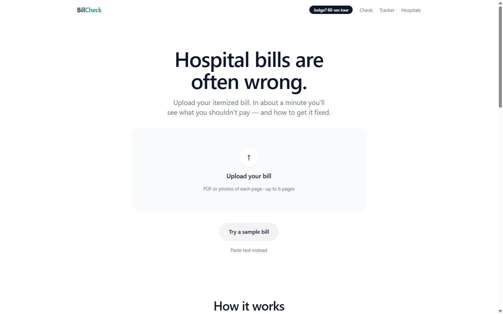
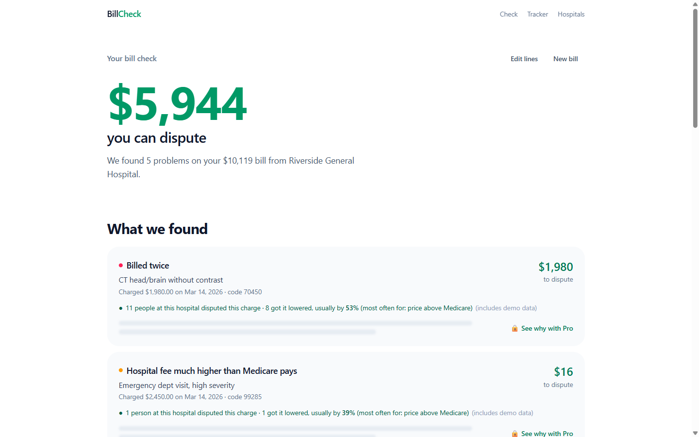
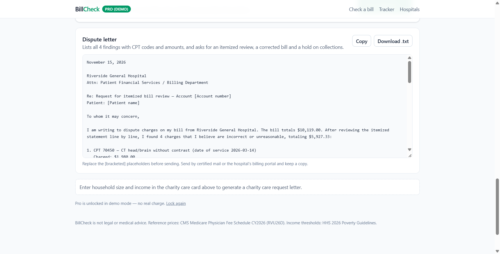
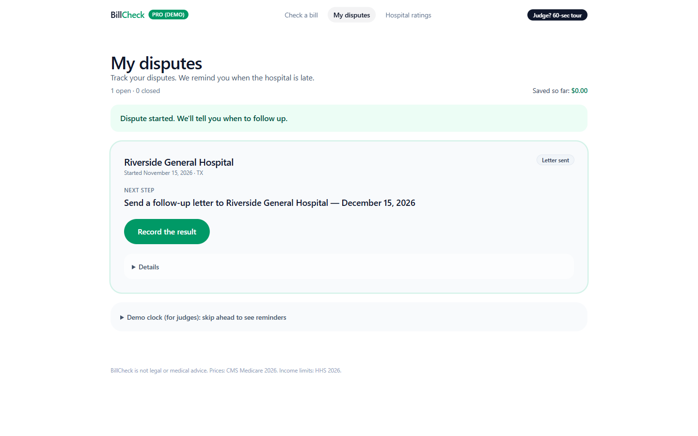
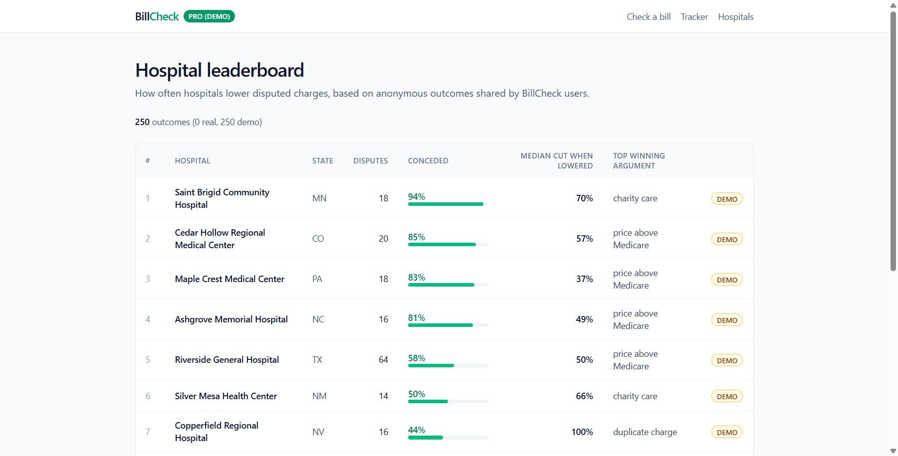

# BillCheck

**BillCheck reads your hospital bill, finds charges you shouldn't pay, and helps you dispute them until the bill is fixed.**

Live app: **https://billcheck-six.vercel.app** · No sign-up, no login. Works on a phone.



---

## See it in 60 seconds

1. Open **https://billcheck-six.vercel.app**.
2. Press **“Judge? 60-sec tour”** in the top bar (it works on every page and on mobile).
3. Follow the tour. It does everything for you, step by step:
   - loads a sample ER bill and the AI reads it live,
   - checks the bill and shows **how much you can dispute**,
   - unlocks Pro (demo, no real charge) and shows the **letter to the hospital**,
   - starts the dispute, **skips ahead 30 days**, and shows the follow-up letter,
   - you type the price the hospital agreed to, and the result joins the **shared list of hospitals**.

Prefer to click yourself? Press **Try a sample bill**, or upload your own PDF or photo.

| Findings | Letter | Tracker | Hospitals |
|---|---|---|---|
|  |  |  |  |

---

## What is real and what is demo

**Real (works with any bill you give it):**
- AI reading of the bill: pasted text, a PDF or photos of each page. The AI only turns the bill into a list of charges. It does not decide what is wrong.
- All checks are our own code, using official 2026 government data (see below). Nothing in the results is hardcoded.
- Letters (dispute, follow-up, escalation, charity care, itemized bill request, No Surprises Act dispute) are filled from your bill.
- Dispute tracker: statuses, day-30 and day-60 steps, calendar file (.ics). Saved in your browser.
- Shared outcomes database (Upstash Redis). When a dispute is closed, an anonymous result is saved: hospital, state, code, original price, final price, and the reason that worked. No names, no dates of service.

**Demo:**
- **Payment.** “Upgrade — $12/mo” is a demo unlock. No real charge.
- **Sample bills.** Sample A (ER visit) and Sample B (outpatient) are made up. The hospitals in them are fictional.
- **Starting data.** 250 results for 10 fictional hospitals are marked `demo` in the database and in the app. Results from the Judge tour and from the sample bills are also saved as `demo`. Only a dispute you start with your own bill is saved as real.
- **Time.** “Simulate +30 days” moves a demo clock so you can see the follow-up step now.

---

## How it works

```
Bill (PDF / photo / text)
   │
   ▼
AI reads the bill  ──►  list of charges (date, code, quantity, price)  ──►  you can edit it
   │
   ▼
Our code checks every charge
   ├─ Billed twice?            same code, same day, same price (unless a modifier says it was really repeated)
   ├─ Physician price          more than 3× the Medicare price   — CMS Physician Fee Schedule 2026 (RVU26D)
   ├─ Hospital fee / ER visit  more than 4× the Medicare price   — CMS Hospital Outpatient (OPPS) 2026, Addendum B
   ├─ Free or cheaper care     income vs. poverty line           — HHS Poverty Guidelines 2026
   └─ Price estimate           bill ≥ $400 above the Good Faith Estimate, within 120 days — No Surprises Act
   │
   ▼
Letters  ──►  Tracker (day 30 follow-up, day 60 escalation, .ics)  ──►  Shared database of results
                                                                           │
                                                                           ▼
                                        “At this hospital, N people disputed this charge …” + hospital ranking
```

Only bills with no codes? BillCheck still finds charges billed twice, and writes a letter asking the hospital for an itemized bill with codes. Only a short summary bill? It writes a request for the itemized bill and reminds you after 14 days.

---

## Data sources

- **CMS Medicare Physician Fee Schedule, CY2026, October release (RVU26D)**, file `PPRRVU2026_Oct_nonQPP.csv`. Price = non-facility total RVU × $33.4009. 3,702 codes in `data/medicare-pfs-2026.json`.
- **CMS Hospital Outpatient PPS, Addendum B, October 2026** (updated 10/15/2026). National payment rate per code. 3,496 codes in `data/opps-2026.json`.
- **HHS 2026 Poverty Guidelines** (48 states + DC, Alaska, Hawaii) in `data/fpl-2026.json`.
- **No Surprises Act**, patient-provider dispute resolution: [CMS — Dispute a medical bill](https://www.cms.gov/medical-bill-rights/help/dispute-a-bill) ($400 threshold, 120 days, $25 fee).
- Nonprofit hospitals must have a Financial Assistance Policy (IRS §501(r)).

The two CMS files are rebuilt from the official downloads with `python -I scripts/build-cms-data.py <PPRRVU2026_Oct_nonQPP.csv> <Addendum B .txt>`. We store only codes and numbers, not the AMA code descriptions.

Medicare prices are a reference point, not a guarantee. BillCheck is not legal or medical advice.

---

## Stack

- Next.js 16 (App Router), React 19, TypeScript, Tailwind CSS 4. Hosted on Vercel (every push to `main` deploys).
- Anthropic Claude API, called only on the server (`/api/extract`). Output is checked with zod; bad lines are dropped and shown.
- Upstash Redis for the shared results and rate limits.
- Bill drafts, the tracker and the demo Pro switch live in the browser (`localStorage`).
- 124 unit tests (Vitest) for the checks, letters, tracker, calendar file and database rules.

## Run it locally

```bash
npm install
cp .env.example .env.local   # add your keys; never commit this file
npm run dev                  # http://localhost:3000
npm test
```

Server-only environment variables: `ANTHROPIC_API_KEY`, `KV_REST_API_URL`, `KV_REST_API_TOKEN`.
Without them the app still works: you can type the charges yourself, and the shared results are hidden.
